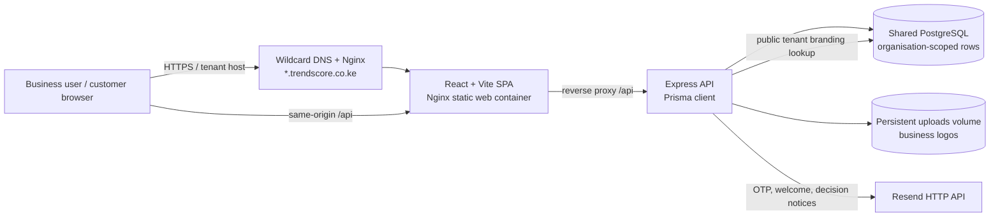

# iQuote Codebase Audit & Technical Assessment

**Audit date:** 18 November 2026 (Africa/Nairobi)  
**Repository snapshot:** branch `main`, commit `bd4beb1` (`feat: PDF download for quotes via @react-pdf/renderer`)  
**Scope:** repository source, schema, configuration, deployment files, documentation, static security review, and safe local checks. No application or production files were changed for this audit; only the requested reports were added. No credentials or customer records were inspected.

**Worktree note:** separate uncommitted changes to `web/src/QuoteWorkspace.tsx` and `web/src/Workspace.css` appeared during final report review. They add dashboard chart/stat and shell UI changes. They were not made or modified by this audit, so the findings below describe the stated commit snapshot. Preserve and review those worktree changes separately.

## 1. Executive summary

iQuote is a real, early-stage SaaS quoting application, not only a landing-page mockup. The current source implements email-code signup, user sessions, one business workspace per account, tenant-scoped customer and catalogue records, server-calculated quotations, public customer approval/decline links, industry starter packs, Resend integration for onboarding/decision messages, direct PDF generation, and a limited super-admin dashboard. The tenancy model is **shared infrastructure**: one web app, one API, one PostgreSQL database, and organisation-scoped rows. Tenant signup does not create a container.

The core quote loop is substantially implemented. The app persists quote records and line items, computes totals on the API, numbers quotes per organisation and year, and presents a tokenized approval page. The latest source also uses `@react-pdf/renderer` for a direct PDF download. The quote email workflow is not complete: the “Mark as sent” action generates a public link and changes the status, but it does not email the customer or attach the PDF. Email is currently used for OTP, welcome, and decision notifications.

The intended wider business-management platform is not present yet. There are no job/production, invoice, payment, receipt, expense, supplier, costing, inventory, or subscription-billing models or workflows. Trial plans are stored as simulated subscriptions. The current industry packs cover handyman, plumbing, electrical, cleaning, construction, and retail; there is no dedicated branding/printing/signage/fabrication pack in the source.

The most important foundation risks are: (1) credentialed CORS reflects arbitrary origins while cookie-authenticated state changes have no CSRF token; (2) uploaded SVG files are served from the app’s origin without sanitization; (3) `JWT_SECRET` silently falls back to a known development value; and (4) there are no Prisma migration files, while deployment uses `prisma db push`. The tenant query pattern is generally organisation-scoped, but the database does not enforce that a quote’s customer belongs to the same organisation as the quote.

**Recommendation:** continue the existing foundation. It is a compact modular monolith with ordinary React/Express/PostgreSQL components and no evidence requiring a rewrite. Stabilize security, database migration discipline, and end-to-end tenant flows before adding financial and production modules.

## 2. Actual technology stack

| Area | Repository evidence | Assessment |
|---|---|---|
| Frontend | `web/package.json`, `web/src/main.tsx` | React 19.3.1, TypeScript, Vite 8.3.6; SPA with client-side path checks and same-origin API in production. |
| Backend | `api/package.json`, `api/src/index.ts` | Node 20 container, Express 4.21.2, TypeScript 5.7.2; a single API process. |
| Database / ORM | `api/prisma/schema.prisma` | PostgreSQL, Prisma 5.22.0. No SQL migration directory is present. |
| PDF | `web/package.json`, `web/src/QuotePdf.tsx` | `@react-pdf/renderer` 4.9.x, browser-side A4 document generation and download link. |
| Authentication | `api/src/index.ts` | bcryptjs password hashes, JWTs, database-backed 7-day sessions, HttpOnly cookie and optional Bearer token. |
| Email | `api/src/index.ts`, `api/src/email-templates.ts` | Direct `fetch` calls to Resend API; no Resend SDK, queue, delivery webhook, or email log model. |
| File storage | `api/src/index.ts`, Compose files | Logo files stored on local API filesystem; production maps `/app/uploads` to a named Docker volume. No object storage/CDN abstraction. |
| UI / styling | `web/src/*.css`, package manifests | Handwritten CSS. No Tailwind, shadcn, or other component library appears in dependencies, despite the older checklist claiming them. |
| Build / package manager | `web/package-lock.json`, `api/package-lock.json` | npm; two independent packages. There is no root `package.json` or workspace manager. |
| Infrastructure | `docker-compose.prod.yml`, `deploy/*` | Docker Compose, PostgreSQL 16 Alpine, Nginx reverse proxy, Certbot scripts, named DB and upload volumes. |
| External services | API source and env templates | Resend is implemented. WhatsApp variables are placeholders and have no source-code consumers. DNS is assumed to be wildcard-configured outside the application. |

### Repository map

```text
api/
  prisma/schema.prisma      Database model definitions (no migrations directory)
  src/index.ts              Express routes, auth, business logic, Prisma access
  src/industry-packs.ts     Seed catalogue/quote templates by business type
  src/email-templates.ts    OTP, welcome, and decision HTML
web/
  src/MarketingSite.tsx     Landing and simulated self-onboarding
  src/QuoteWorkspace.tsx    Main tenant workspace and quote editor
  src/QuoteDocument.tsx     HTML preview and browser print layout
  src/QuotePdf.tsx          React-PDF document and download link
  src/PublicQuote.tsx       Public quote review and customer decision
  src/SuperadminDashboard.tsx Platform-wide admin screens
  src/*.css                Handwritten styles
deploy/                     Compose/Nginx/Certbot deployment scripts and configs
scripts/                    Super-admin bootstrap/promotion and checklist helper
docs/audit/                 This report set
```

There is one Express API with domain functions and Prisma calls concentrated in `api/src/index.ts` (about 1,580 lines). The React front end has distinct screens/components but also retains a large unreachable older workspace return in `web/src/App.tsx` after the active `<QuoteWorkspace />` return (around line 599). This is a **modular monolith**, not a distributed service architecture.

## 3. System architecture



This shows the repository-declared topology. The public site and production runtime could not be independently reached from this audit environment: DNS lookup for `iquote.trendscore.co.ke` failed here. The diagram is not evidence that the current production server matches the repository snapshot.

## 4. Module-by-module implementation assessment

| Module | What exists | What is missing / caveat |
|---|---|---|
| Authentication and onboarding | Four-step marketing/signup flow, OTP hash/expiry/attempt limit, login/logout, hashed password, 7-day JWT/session, business and simulated trial creation in a transaction. | No password reset/change, MFA, account deletion, workspace switcher, invitations, or membership management. Rate limiting is in-memory and login-only. |
| Business workspace | Business profile, country/currency/tax/quote prefix, logo/payment instructions/terms, generated business-name subdomain. | One `organisationId` per user; no real multi-workspace membership flow. Domain routing depends on external wildcard DNS, Nginx, and TLS. |
| Super-admin | Role guard, aggregate stats, paginated workspace and recent quote lists, promotion scripts. | No suspend/reactivate, edit workspace, manage users, billing control, platform configuration UI, or admin audit trail. Global quoted-value aggregation mixes currencies. |
| Dashboard | Workspace-specific quote count, awaiting-response count, approved value, six recent quotes, empty state. | Loads full quote list first; no data freshness/background refresh, activity feed, revenue/reporting, or performance pagination. |
| Customers | Create/read/update/delete; requires name plus phone or email; search in browser. Deletion is blocked when quotes exist. | No duplicate detection, archive, dedicated customer quote history, import/export, pagination, or strong contact format validation. |
| Products/services | Tenant-owned catalogue with service/product kind, category, description, unit, price, optional tax, archive, and starter packs. | No inventory/stock, supplier purchasing, variants, price history, or product-specific workflow. Current pack set is generic and lacks print/signage/fabrication. |
| Quote templates | Tenant-owned template name/description, line descriptions/units, default notes and terms; industry starter templates. | These are **quote content templates**, not visual PDF templates. No template edit/delete UI or visual template designer. |
| Quotations | Create/edit drafts, customer, validity, notes/terms, line quantity/unit/price/tax; server validates and computes totals; sequence per organisation/year; status lifecycle. | No discounts, revisions, duplication, quote audit history, approval limits, multi-currency per quote beyond workspace currency, or email-send operation. Only drafts are editable. |
| PDF | Direct download through `@react-pdf/renderer`; A4 layout, line table, totals, business details/logo, notes/terms, page footer/page numbering. HTML preview remains a separate implementation; Print remains browser dialog. | Visual PDF output and page-break behavior have not been reviewed in a browser/PDF viewer during this audit. The HTML preview and PDF can drift. No stored PDF or email attachment flow. |
| Email | Resend HTTP integration for OTP, welcome, approval/decline notifications; platform sender and per-tenant key settings; encrypted tenant key field. | No send-quote email, PDF attachment, send queue, delivery log, webhook state, retries, bounce handling, or verified-domain enforcement before attempting tenant email. |
| Customer public quote | High-entropy random token link, view status/time, approve/decline with optional comment, expiry check, asynchronous owner notification. | No change-request state, token revocation/regeneration, rate limiting, document versioning, or explicit privacy/consent record. |
| Payments / financials | Quote totals only; workspace payment instructions are display text. | No payment, invoice, receipt, deposit, refund, balance, tax filing, ledger, or reconciliation implementation. |
| Production / job management | None found. | No job conversion, production stages, job card, schedule/deadline, attachments, supplier, delivery, or completion records. |
| Expenses / profitability | None found. | No expense/cost data, material/labour allocation, estimate-vs-actual, or profit reporting. |
| WhatsApp | WhatsApp share URL from the quote link in the browser. | WhatsApp Business API/Cloud API is not implemented; the env placeholders are unused. The current link opens a user-operated WhatsApp share flow, not platform delivery. |

## 5. Super-admin assessment

The API uses a dedicated `requireSuperadmin` middleware that verifies the active session and checks `User.role === 'SUPERADMIN'` (`api/src/index.ts:329-345`). The front end routes this role to `SuperadminDashboard`. Endpoints provide global counts, recent signups, paginated workspaces, and paginated quote summaries (`api/src/index.ts:1421-1538`). CLI scripts can seed/promote the first administrator.

This is a **monitoring dashboard**, not an operational admin console. It cannot suspend or restore workspaces, administer user membership, change trials/plans, inspect delivery incidents, or record administrative actions. `/api/superadmin/promote` is role-protected, but there is no second-person approval or audit history. `/api/superadmin/stats` sums quote totals across every organisation without currency grouping, so `totalQuotedValue` is not a financially meaningful single amount when tenants use different currencies.

## 6. Tenant isolation assessment

The app uses one shared database and resolves a signed-in user’s workspace from `User.organisationId`, falling back to the organisation they own (`api/src/index.ts:201-206`). Customer, service-item, template, quote, and email-settings routes generally obtain this organisation ID and scope reads/updates/deletes by it. Quote creation and editing verify the selected customer belongs to the current organisation. Super-admin APIs intentionally aggregate across organisations.

Positive evidence:

- Signup creates `User`, `Organisation`, `Subscription`, starter items, and templates within a transaction (`api/src/index.ts:443-469`).
- Quote/customer/service/template queries generally include `organisationId` filters.
- Subdomains are unique at the database level; an advisory lock serializes slug allocation (`api/src/index.ts:208-243`).
- Tenant hostname lookup is used for public branding; private data access still uses the signed-in account, not a client-supplied tenant ID (`api/src/index.ts:356-368`).

Limitations and risks:

- There is no PostgreSQL row-level security. Isolation is enforced in application query code.
- The database does not enforce `Quote.organisationId = Customer.organisationId`; application checks cover current quote write paths, but inconsistent references remain possible through future code or direct DB writes.
- `Customer.organisationId` is nullable, reflecting legacy or partial workspace setup.
- `User.organisationId` is a single optional scalar. The `members` relation does not create multi-workspace membership or switching; operationally this is one workspace per account.
- No end-to-end cross-tenant test suite exists. Isolation is source-reviewed, not verified by adversarial tests.
- Wildcard DNS and TLS are infrastructure prerequisites. The code can allocate a subdomain but cannot create DNS records or certificates.

**Conclusion:** application-level tenant isolation is present and mostly consistent in inspected tenant routes, but it is not defense-in-depth at the database layer and has not been proven by automated isolation tests.

## 7. Quotation calculation and persistence

`normalizeQuoteLines` validates nonempty descriptions, quantity greater than zero, nonnegative unit price, and tax from 0 to 100; it calculates subtotal/tax/total on the server and rounds aggregate values to two decimals (`api/src/index.ts:259-296`). PostgreSQL values use `Decimal`; sequence values are incremented through a per-organisation/per-year `QuoteSequence` row in a transaction (`api/src/index.ts:938-985`). This is better than trusting browser totals, although calculations use JavaScript floating point before persistence and should be covered by currency/rounding tests.

There are no discounts or revision records. Saving an edited draft deletes/recreates its line rows inside a transaction (`api/src/index.ts:999-1039`). Quote status gates editing and deletion, and public decision writes use a guarded update. The “share” operation only checks for a nonempty line list, marks the quote `SENT`, and creates a public token (`api/src/index.ts:1050-1066`). It performs no customer email send.

## 8. PDF and email assessment

The current PDF implementation is a React-PDF document (`web/src/QuotePdf.tsx`) and uses `PDFDownloadLink`; the library/package lock is present. It includes the logo URL, organisation/customer details, line items, tax, totals, notes/terms/payment instructions, and a fixed page footer. The live HTML quote preview is implemented separately (`web/src/QuoteDocument.tsx`), so layout parity is a maintenance concern. Generated PDFs are browser-side downloads and are not persisted.

The API has a single `sendEmail` helper that chooses a tenant key when custom email is enabled, otherwise the platform key, and sends HTML through `https://api.resend.com/emails` (`api/src/index.ts:163-199`). Calls exist for signup verification, welcome messages, and decision notifications. Welcome and decision failures are intentionally swallowed after workspace/decision creation; no log records explain later delivery state. Verification errors return an error to the signup screen. There is no attachment field in the Resend request body.

## 9. Deployment and production-readiness assessment

- `docker-compose.prod.yml` describes one shared PostgreSQL 16 container, API and web containers, plus persistent database and upload volumes. This matches the shared-tenancy design in `README.md`.
- `deploy/deploy.sh` fetches and hard-resets `/srv/iquote` to `origin/main`, builds/starts Compose, calls `prisma db push`, and installs an Nginx site. It is an operator-run server script, not GitHub Actions CI/CD. No `.github/workflows` are present.
- The deployment health probe requests `/api/health`, but the API defines `/health` and `/api/ping`; there is no `/api/health` route (`deploy/deploy.sh` around line 85; `api/src/index.ts:348-354`). The script can warn after its wait then continue.
- Prisma migrations are absent. `db push` makes database shape follow the checked-out Prisma schema without a reviewed migration history or an application rollback plan.
- `deploy/provision-ssl.sh` provisions the single iQuote host then prints manual wildcard DNS-certificate instructions. `deploy/wildcard-ssl.sh` uses a human-managed DNS challenge hook; wildcard TLS renewal/provisioning still depends on external DNS and host state.
- `api/.env.example` and `.env.prod.example` are templates. Real production secret values were not read. No `api/.env.prod` or root `.env.prod` exists in the repository checkout; this says nothing about files on the server.
- Upload persistence is a Docker named volume. Backup/restore commands or tested disaster-recovery procedures are not included in the repository.
- The public live hostname could not be resolved from the audit environment, so response status, deployed build SHA, container health, certificate state, and production email delivery could not be independently checked.

## 10. Performance and scalability

The current stack can support an initial small-business pilot without a rewrite. It needs operational and query improvements before significant growth:

- Workspace data fetch loads all customers, quotes, products, and templates in parallel on initial workspace load (`web/src/QuoteWorkspace.tsx:150-170`). Customer and quote search is client-side.
- `/api/quotes` performs an expiry update then returns every quote with related customer and lines (`api/src/index.ts:920-935`). There is no tenant quote pagination or server-side filtering.
- `/api/customers` returns every customer. Large workspaces will use increasing memory/network and slower browser filtering.
- Login throttling is an in-process `Map`, resets on restart, and is not shared across multiple API replicas (`api/src/index.ts:19-52`). There is no background queue for email/PDF or recurring maintenance.
- One PostgreSQL instance and one API process are straightforward to grow vertically. Stateless API scaling is possible, but in-memory rate limits and local-volume file writes need shared services or sticky/consistent handling.
- PDF rendering is in the browser, which avoids API PDF load but depends on client memory and unverified pagination for unusually large quotations.

## 11. Engineering checks and limits

Checks performed without generating build artifacts:

- API TypeScript: `npx tsc --noEmit` — passed.
- Web app and Vite config TypeScript: `npx tsc --noEmit -p tsconfig.app.json` and `tsconfig.node.json` — passed.
- Web lint: `npm run lint` — exited successfully with 9 warnings (React purity/set-state-in-effect/missing dependency warnings); no errors.
- `npm audit` for API and web, including development dependencies — each reported 0 vulnerabilities at audit time.
- No test files/specs or `test` scripts were found. No automated tests could be run.
- Production build was not run because it writes generated output; PDF visual/browser behavior was therefore not verified.
- These checks were run against the reported commit before the uncommitted `QuoteWorkspace.tsx`/`Workspace.css` worktree edits were noticed; they do not validate those separate edits.
- Live site request failed at DNS resolution from this environment. No production DB or secret values were accessed.

TypeScript is strict in both packages. The main maintainability issue is concentration: API routes, validation, auth, email, file handling, and business rules share one large file. There is repeated manual validation instead of a shared schema layer. `web/src/App.tsx` contains an older unreachable workspace renderer after the active workspace return. `CHECKLIST.md`, `DESIGN.md`, and `progress.json` do not consistently describe the source: the checklist claims Tailwind/shadcn, defers industry packs, and says PDF is browser print, while current dependencies/code differ.

## 12. Critical risks and priorities

1. **Credentialed reflected CORS and CSRF exposure.** Restrict allowed origins and add a deliberate CSRF strategy before broad user rollout.
2. **Unsafe SVG upload.** Sanitize/re-encode SVG or reject SVG; serve user-controlled media from a separate origin or use safe raster formats.
3. **JWT configuration fallback.** Fail startup in production when `JWT_SECRET` is absent/weak; rotate the default and consider hashed opaque session tokens.
4. **No migration history.** Adopt Prisma migrations, backup/restore procedure, and deploy migrations with review and rollback strategy.
5. **Quote send semantics.** “Mark as sent” creates a shareable link, but no email or attachment is sent; product copy and actual send workflow should align.
6. **Missing automated tenant and workflow tests.** High-risk isolation and money paths lack tests even though the code checks passed.
7. **Unverified production.** Repository configuration cannot establish which revision, secrets, DNS, TLS, database schema, or Resend account are active on the server.

## 13. Prioritised roadmap overview

### Phase 1 — Fix existing problems and stabilise the foundation

Lock down CORS/CSRF, reject weak production secrets at startup, make uploaded media safe, add API rate limiting, introduce Prisma migrations, and add automated auth/tenant/quote tests. Correct the deploy health probe and add CI that runs typecheck/lint/tests and validates a build before deployment. Complexity: **Medium to Large**.

### Phase 2 — Complete the core quotation and customer workflow

Add customer archive/history/duplicate controls, server-side list pagination/search, quote duplication and revision strategy, editable templates, and the actual customer email/send workflow. Build parity checks between HTML preview and PDF. Complexity: **Medium**.

### Phase 3 — Introduce customer approval and professional document delivery

Add email with PDF attachment, send/delivery log, retries/webhooks, explicit resend, token revoke/expire controls, change-request state, business-branded delivery, and clear delivery status. Complexity: **Medium to Large**.

### Phase 4 — Introduce production, job costing and payment management

Create quote-to-job conversion, job stage/history, materials and labor costing, expenses, deposits/partial payments, receipts, balances, and reports with immutable financial events. This is a data-model expansion and requires careful migration and accounting requirements. Complexity: **Large**.

### Phase 5 — Introduce SaaS subscriptions, integrations and advanced reporting

Connect a billing provider and webhooks, add team invitations/roles, administration/suspension/audit logs, WhatsApp Business Platform under consent/templates, business reports, and operational monitoring/backups. Complexity: **Large**.

See `IQUOTE_TECHNICAL_ROADMAP.md` for recommendation details, dependencies, files and estimates; see the database/security/feature reports for supporting evidence.
